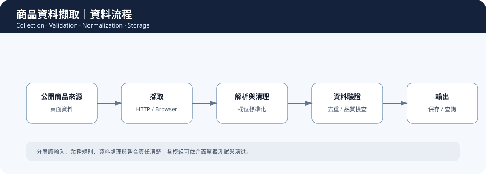

# 酒類商品資料擷取

以靜態與動態網站擷取酒類商品資訊，將來源差異封裝在抽象抓取器之下，再統一輸出資料規格，降低新增來源和維護既有抓取器的成本。

## 架構設計

- **抽象抓取介面**：共用流程透過統一介面呼叫來源抓取器，不需耦合各網站頁面細節。
- **靜態／動態策略分離**：靜態頁面和需執行 JavaScript 的頁面由不同實作處理，依來源選擇合適方式。
- **共同資料模型**：各來源解析後轉成一致欄位格式，供後續保存、比對或分析。
- **可維護性**：新增網站以擴充來源實作為主，共用流程與輸出契約保持穩定。

這種分離可用 Adapter/Strategy 的架構思路說明：將網站差異封裝在各自實作，讓調度與後續資料處理依賴共同契約。

English: A web-scraping system that abstracts static and dynamic sites behind a shared interface and normalizes product records to one schema.
