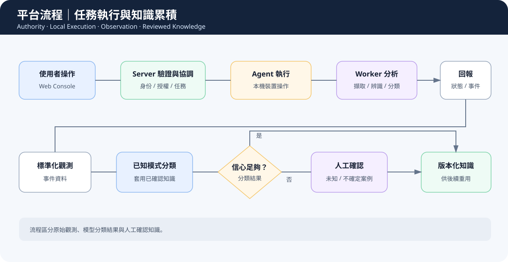

# 執行與知識累積流程

## 任務執行

Web UI 提出操作請求，Server 負責身份、授權與任務政策檢查；本機 Agent 接收允許的執行工作，必要時調用 Worker 做訊號或影像分析，最後將狀態與觀測結果回報 Server。

## 觀測轉知識

擷取資料先轉成標準事件格式，再由分析流程辨識已知情況。未知或低信心結果進入人工確認；確認後整理為有版本的知識／規則，供後續流程重用。原始觀測、推論結果與已確認知識保持可區分，避免把模型推論直接當成事實。

## 設計重點

- Server 是授權與平台狀態的權威來源。
- Agent/Worker 的責任是執行與分析，不取代 Server 的裁決。
- 分析結果可追溯來源及版本，未知案例保留人工確認步驟。
- 新目標透過薄型模組加入，不重複建置平台共用底盤。
