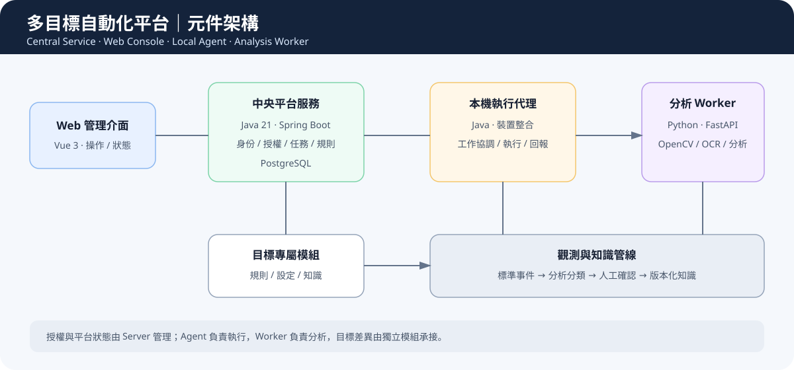
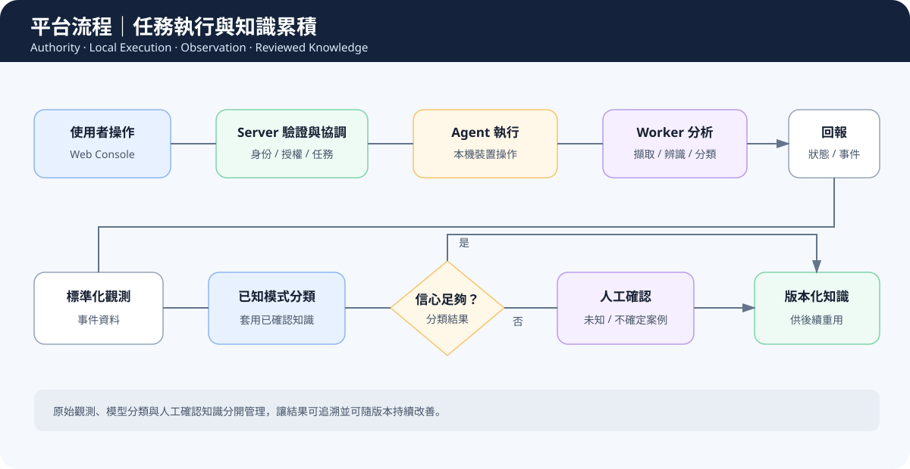

# 多目標自動化與訊號分析平台

以多語言元件組成的自動化平台，將管理介面、中央服務、本機執行代理與可替換分析 Worker 分層，並將觀測資料整理成可累積的知識與規則。

## 技術組成

| 元件 | 語言與技術 | 職責 |
|---|---|---|
| 中央服務 | Java 21、Spring Boot 3.3.1、PostgreSQL | 帳號、授權、裝置與任務協調、狀態與規則管理 |
| Web 管理介面 | Vue 3、Element Plus、Vue Router、Pinia、Vite | 操作入口、狀態呈現及任務控制 |
| 本機執行代理 | Java | 裝置環境整合、擷取與本機執行協調 |
| 分析 Worker | Python 3.11+、FastAPI、OpenCV、OCR | 訊號處理、影像辨識與分析工具 |
| 知識整理 | 標準化事件資料、版本化 Markdown 知識 | 將觀測結果整理為可查詢、可維護的知識資產 |

## 系統架構

平台共用服務負責帳號、授權、生命週期與共用能力；不同目標以薄型模組提供各自設定、規則與知識，不複製整套底層。Web UI、Server、Agent、Worker 的責任邊界分明，中央服務保留授權與政策裁決權，本機元件執行授權範圍內的工作並回報結果。

## 主要流程

執行流程涵蓋 Web 操作、服務端驗證與任務協調、本機代理執行、Worker 輔助分析及結果回傳。觀測資料經標準化後進入知識整理流程；已知情況使用已確認規則，未知情況交由分析與人工確認，再將驗證後知識納入後續版本。

## 架構與程式規劃

- **DDD / Bounded Context**：服務端按平台帳號、授權、裝置、任務及目標模組劃分責任。
- **Ports and adapters 邊界**：Agent 與 Worker 封裝本機環境、裝置工具及辨識元件，平台服務不直接耦合特定工具。
- **Server-authoritative security**：身份、授權、政策與版本狀態由中央服務決定；用戶端只負責呈現或執行。
- **模組擴展**：共用任務生命週期、資料契約與執行底盤；新目標透過獨立模組與知識加入。
- **資料契約**：以明確 DTO、Enum 與錯誤模型表達跨層資料，避免用鬆散字典承載長期 API 契約。
- **可演進的分析管線**：原始觀測、標準化事件、分類結果與人工確認知識分層保存，讓分析器可替換並可追溯。

English: A multi-target automation and signal-analysis platform with a central service, web console, local agent, replaceable workers, and a versioned knowledge pipeline.
