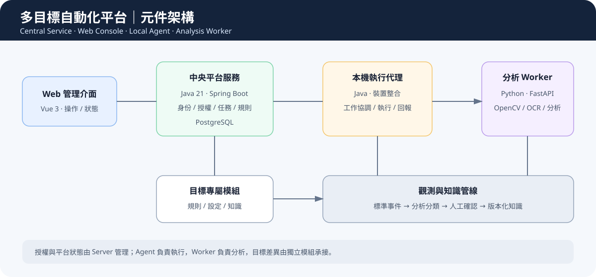

# 平台架構

## 技術分層

| 元件 | 技術 | 設計責任 |
|---|---|---|
| Server | Java 21、Spring Boot 3.3.1、PostgreSQL | 平台 API、身份／授權、任務協調、狀態與規則真相 |
| Web UI | Vue 3、Element Plus、Router、Pinia、Vite | 統一操作入口與狀態呈現 |
| Local Agent | Java | 本機裝置整合、執行協調、結果回報 |
| Worker | Python 3.11+、FastAPI、OpenCV、OCR | 可替換的擷取、辨識與分析工具 |
| Target modules | 模組化設定、規則與知識 | 描述目標差異，不複製共用平台能力 |

## 分層原則

1. Server 維護身份、授權、政策與平台狀態。
2. Web UI 發起使用者操作，但不持有安全裁決權。
3. Agent 負責本機能力與動作執行，不自行授權。
4. Worker 提供可替換的分析工具，不持有平台最終狀態。
5. 目標專屬差異位於模組邊界，共用生命週期與資料契約留在平台層。

## 程式結構風格

- Java Server 使用輕量 DDD 與 bounded contexts 組織應用層。
- 跨層 API 使用 DTO/Enum/錯誤契約，避免 `Map` 作為長期資料模型。
- Agent、Worker 與 Server 依介面和版本化契約協作，降低多語言元件耦合。
- 遊戲／目標知識與平台基礎程式分離，方便獨立演進及替換分析器。
