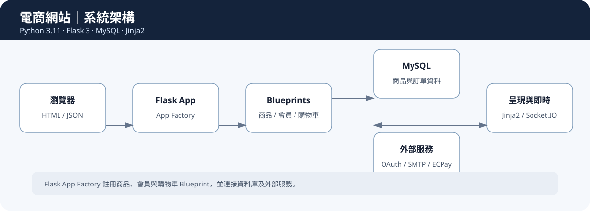

# 電商網站系統架構

| 模組 | 程式責任 |
|---|---|
| Flask App Factory | 載入設定、初始化擴充及註冊 Blueprint |
| 商品 Blueprint | 商品分類、搜尋、分頁與 JSON 回應 |
| Auth Blueprint | 會員登入與 OAuth 驗證路由 |
| 購物車 Blueprint | Session 購物車、庫存查詢與結帳資料整理 |
| Database helper | MySQL 查詢與更新 |
| 外部整合 | ECPay、SMTP、Socket.IO |
| Templates | Jinja2 頁面呈現 |
