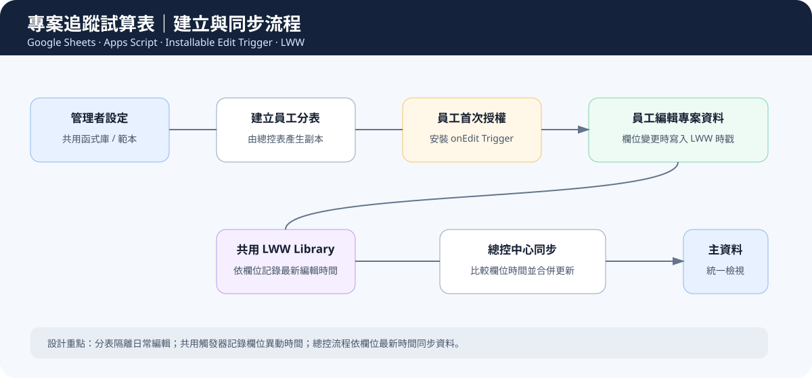

# 試算表專案追蹤同步

以 **Google Sheets 與 Google Apps Script（JavaScript）** 建立員工分表及專案總控流程，透過共用 LWW 函式庫記錄欄位更新時間，協助將分表編輯同步回主資料。

## 元件與職責

| 元件 | 職責 |
|---|---|
| 員工專案範本 | 提供一致欄位與分表結構 |
| 共用 LWW Library | 由安裝型 onEdit trigger 呼叫，依編輯欄位更新對應時間戳 |
| 模板載入腳本 | 連結共用函式庫並建立 trigger |
| 主控中心與管理腳本 | 維護人員清單、建立員工分表及同步資料 |

## 設計重點

- **欄位級衝突處理**：每個資料欄位有對應的 LWW timestamp，主控流程可依最新編輯時間判斷採用哪一份值。
- **程式碼重用**：核心編輯追蹤邏輯置於 Library，模板腳本只負責觸發器設定與轉呼叫。
- **資料隔離與管理**：員工使用個別工作表，管理者由總控表建立分表並集中管理。
- **授權生命週期**：首次使用時由員工授權並建立 installable trigger，讓後續編輯事件能執行共用函式庫。
- **集中設定**：角色、欄位索引、追蹤欄位及狀態由共用設定管理。

English: A Google Sheets and Apps Script workflow that creates staff workbooks and synchronizes field-level changes through last-write-wins timestamps.
