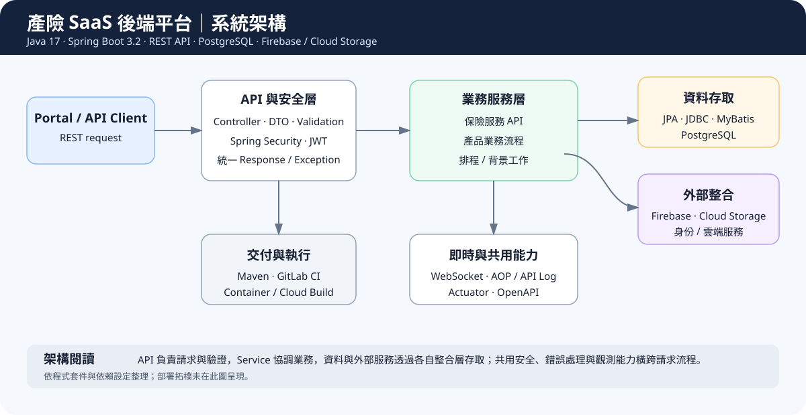
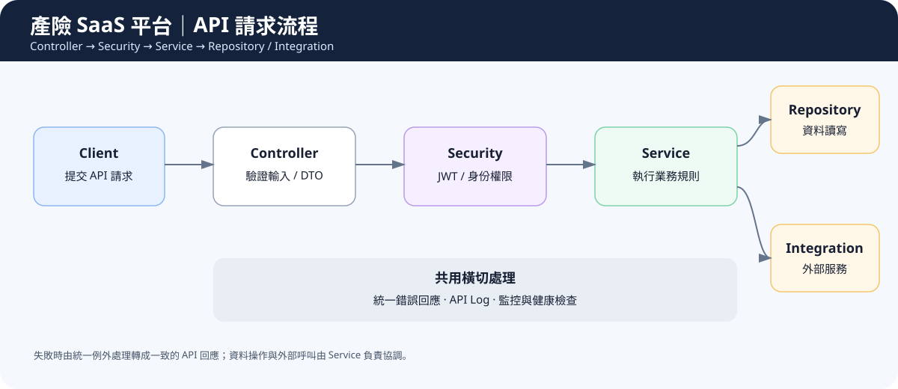

# 產險 SaaS 後端平台

Java 17、Spring Boot 3.2.5 產險 SaaS 後端服務。負責車險與旅平險 API 開發。程式包含 Controller、Service、Worker、資料存取、驗證及外部服務整合元件。

## 技術組成

| 類別 | 技術 |
|---|---|
| 語言與框架 | Java 17、Spring Boot 3.2.5、Spring Web、Spring Security |
| API 與驗證 | REST、Bean Validation、JWT、OpenAPI/Swagger |
| 資料存取 | PostgreSQL、Spring Data JPA/JDBC、MyBatis |
| 其他元件 | Spring Batch、Scheduling、WebSocket、Firebase Admin、Google Cloud Storage |
| 建置 | Maven、GitLab CI、Cloud Build/Deploy |

## 架構與 API 流程

Controller 接收與驗證 API 請求，Service 負責應用流程，Worker 封裝外部服務呼叫，DAO/Repository 負責資料存取。專案使用 DTO、Entity、JWT Filter、共用錯誤及回應元件。

## 程式結構

| 元件 | 程式中的用途 |
|---|---|
| Controller / DTO | API 入口、請求驗證及輸入輸出資料契約 |
| Service | 應用流程處理 |
| Worker | 外部 REST、Auth、SSO 與雲端服務整合 |
| DAO / Repository / Entity | 資料查詢、儲存及持久化模型 |
| Security Filter | JWT 驗證與身份上下文 |
| Base / AOP | 共用回應、例外及日誌處理 |

English: Developed car and travel insurance APIs in a Java 17 / Spring Boot SaaS backend.
