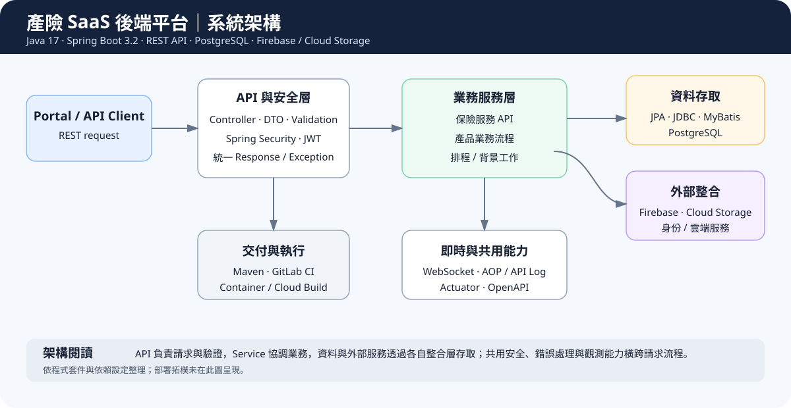

# 產險 SaaS 平台架構

## 技術堆疊

Java 17、Spring Boot 3.2.5、Spring Web/Security、Bean Validation、PostgreSQL、Spring Data JPA/JDBC、MyBatis、Spring Batch、Scheduling、WebSocket、Firebase Admin、Google Cloud Storage、Maven、GitLab CI。

## 模組與模式

| 模組／模式 | 職責 |
|---|---|
| Controller + DTO | API 輸入驗證、契約與回應轉換 |
| Service | 業務規則與跨元件流程協調 |
| DAO / Repository | 資料存取抽象 |
| Worker | Auth、SSO、Cloud Storage 等外部整合 |
| Security Filter Chain | JWT 驗證、身份建立及權限檢查 |
| AOP / Base | 共用日誌、例外及回應處理 |
| Scheduled / Batch | 定時及批次工作 |

程式模組以 app、driving、rentDriver、rentStore 等領域目錄組織。架構以分層、DTO、Repository、依賴注入與 Adapter 邊界為主；外部服務在 Worker 層隔離。
