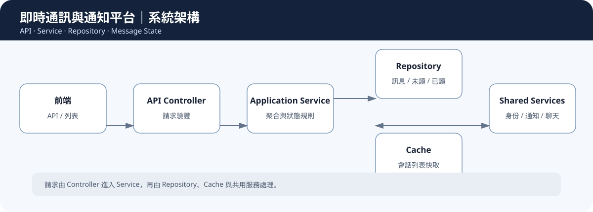
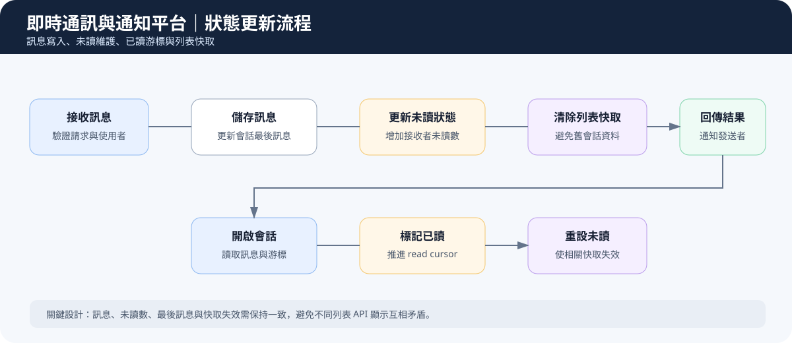

# 架構與狀態流程

API Controller 接收前端請求，Application Service 聚合通知與會話資料並維護狀態；Repository 封裝訊息、未讀與已讀狀態的查詢／更新；Cache 提供列表快取，狀態變更時需失效；共享身份、聊天與通知服務負責跨模組整合。

訊息儲存、接收者未讀數、最後訊息與列表快取需同步更新。使用者開啟會話後推進已讀游標、重設未讀並清除快取，以維持列表狀態一致。
