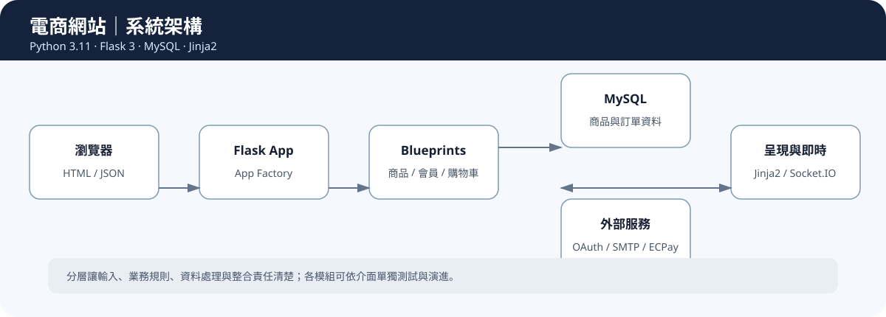

# 電商網站系統架構

| 模組 | 責任 |
|---|---|
| Flask App Factory | 設定載入、擴充初始化及 Blueprint 註冊 |
| 商品 Blueprint | 商品分類、搜尋、分頁與 JSON 回應 |
| Auth Blueprint | 會員登入與 OAuth 驗證流程 |
| 購物車 Blueprint | Session 購物車、庫存檢查及結帳資料準備 |
| Database helper | MySQL 查詢與更新 |
| 外部整合 | ECPay、SMTP、Socket.IO |
| Templates | Jinja2 頁面呈現 |

## 改善方向

將路由中的商業規則拆至 Service、SQL 拆至 Repository，明確管理連線生命週期；結帳時在資料庫交易內重查價格與庫存並建立訂單，付款通知採簽章驗證及冪等更新。
