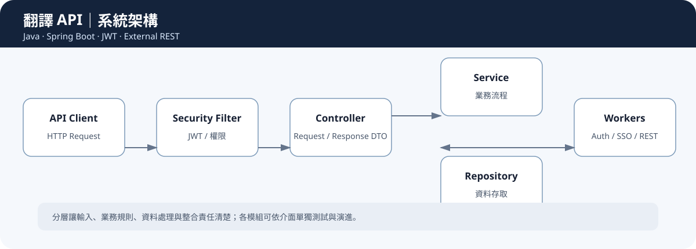

# 翻譯 API 架構

## 模組責任

| 模組 | 設計責任 |
|---|---|
| Controller | HTTP endpoint 與 request/response DTO |
| Service | 業務流程與模組協調 |
| Repository/DAO | Entity 與資料存取 |
| Worker | 翻譯、認證、SSO 及外部 REST 整合 |
| Security | JWT 身份驗證與權限控制 |
| Base/AOP | 共用回應、錯誤、日誌與工具 |

Controller、Service、資料存取與外部整合各自分層，使 API 契約、業務規則及基礎設施依賴可以分別維護與測試。
