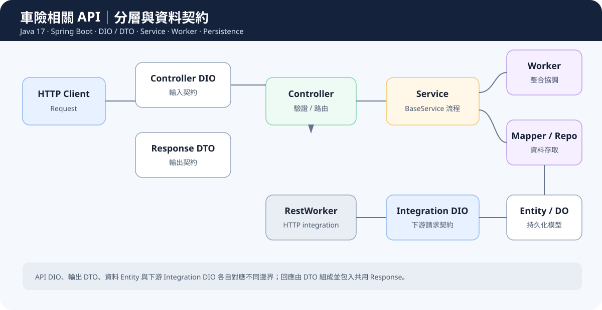

# 車險相關 API 結構

**語言與框架：** Java 17、Spring Boot 3.2.5。此案例聚焦車險類別與車輛 API 周邊的程式結構：DIO/DTO、Controller、Service、Worker、Mapper/Repository 與 Entity，不描述保險業務規則。

## 架構圖

## 模組分工

| 層級 | 程式結構 | 責任 |
|---|---|---|
| API 輸入 | Controller DIO | 承接 HTTP 請求資料，定義輸入契約 |
| API 輸出 | Controller DTO | 定義回應資料形狀，包含列表與分頁回應 |
| Controller | Spring REST Controller | 接收請求、驗證輸入、呼叫應用服務、封裝共用 Response |
| Service | `BaseService<DIO, Result>` 實作 | 組織處理步驟並產生標準回應 |
| Worker | Component / Worker | 封裝跨模組操作與資料存取協調 |
| Persistence | Mapper、Repository、Entity | 對應查詢、資料模型與儲存操作 |
| 外部 API | `RestWorker` + integration DIO | 封裝下游 HTTP 請求及其資料契約 |

## DIO 與 DTO 的界線

- **DIO** 在 Controller 層代表 API 輸入物件；在外部整合層也用來描述送往下游服務的請求資料。專案以套件位置區分用途。
- **DTO** 描述 API 回傳資料，並可組合項目清單、分頁資訊及共用回應格式。
- **Entity/DO** 對應持久化模型；不直接等同於 API 輸入或回應契約。
- JSON 欄位名稱、序列化註記及 OpenAPI Schema 集中在資料物件上，讓 API 契約可被文件化。

## 設計模式與程式風格

- **Layered Architecture**：將 HTTP、應用處理、整合協調與持久化責任拆層。
- **Template Method**：Service 繼承共用 `BaseService`，透過 `processData` 與 `generateResult` 提供領域實作。
- **Repository / Data Mapper**：以 Repository 與 MyBatis Mapper 封裝資料存取方式。
- **Dependency Injection**：以 Spring 建構子注入明確表達元件依賴。
- **DTO boundary**：用獨立輸入／輸出型別隔離 API 契約、內部資料模型與下游服務契約。

## 程式範圍說明

程式中可確認有車險類別 enum、車輛管理 API 結構及客戶資料外部整合元件。現有程式未找到明確連結車險類別的專屬 Controller／Service 請求鏈；客戶資料整合元件在程式中的呼叫點屬於另一個服務流程。因此本案例只呈現可驗證的分層與資料契約，不把周邊模組推演成車險流程。

English: A code-structure case study of Java/Spring vehicle-insurance-related APIs, focused on DIO/DTO contracts and layered design.
