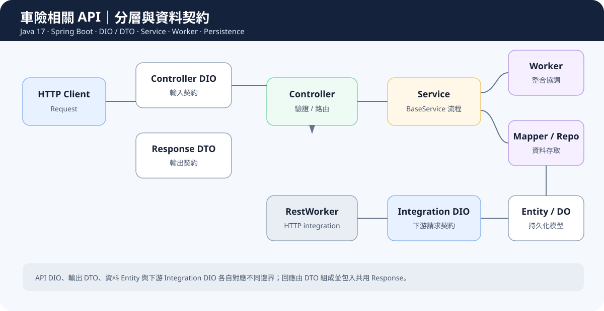

# 車險相關 API 架構



## 專案技術

Java 17、Spring Boot 3.2.5、Spring Web、Spring Security、Bean Validation、OpenAPI、PostgreSQL、Spring Data JPA/JDBC、MyBatis。

## 程式分層

```text
HTTP Request
  → Controller DIO
  → Controller
  → Service / BaseService
  → Worker
  → Mapper / Repository
  → Entity / Database
  → Response DTO
  → Common Response
```

外部 API 請求由 integration Worker 封裝，使用對應的 DIO 描述下游請求契約，再透過共用 RestWorker 發送。API DTO、持久化 Entity 與 integration DIO 各自代表不同邊界，避免直接共用同一資料模型。

## 設計模式

| 模式 | 程式中的位置 | 用途 |
|---|---|---|
| Template Method | `BaseService` 與具體 Service | 共用處理骨架，子類提供資料處理及回應組裝 |
| Repository / Data Mapper | Spring Repository、MyBatis Mapper | 隔離資料來源與查詢細節 |
| Dependency Injection | Spring Bean 與建構子注入 | 管理元件生命週期及依賴關係 |
| DTO boundary | DIO、DTO、Entity 分離 | 保持 API、下游整合、資料庫模型各自獨立 |

本文件描述類別責任及呼叫層次，不展開車險業務規則。
