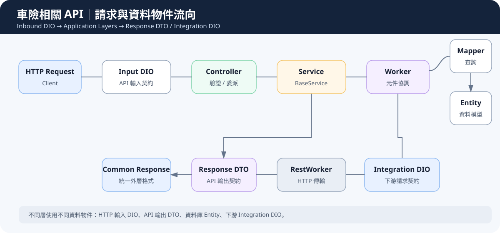

# API 資料流與契約邊界

## 輸入到回應

1. Controller 接收 HTTP 請求，將輸入映射至 Controller DIO。
2. Controller 呼叫對應 Service，並以共用基底流程處理結果封裝。
3. Service 透過 Worker 協調資料存取或外部服務元件。
4. Mapper/Repository 操作 Entity/DO，回傳資料供服務層轉換。
5. Service 組成回應 DTO，由 Controller 包裝為共用 Response。

## 外部服務邊界

整合 Worker 使用專屬 integration DIO 表達下游 API 請求，並透過共用 REST 元件處理 HTTP 通訊。下游契約不與 Controller DIO 或資料庫 Entity 共用。

此流程圖呈現程式分層與資料物件邊界，不描述車險規則、計價或承保流程。
